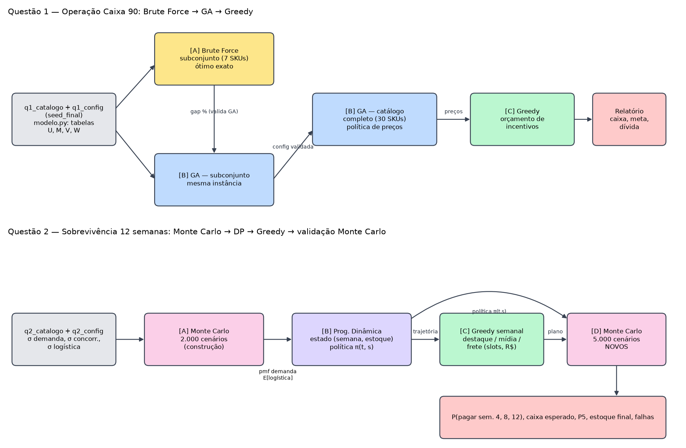

# Checkpoint 6 — Recuperação financeira de varejistas por precificação online

FIAP · Dynamic Programming · Prof. André Marques

| | |
|---|---|
| **Grupo** | G05 |
| **Integrantes** | Guilherme Moura Gama — RM 562162 · Guilherme Ruiz Costa — RM 563236 · Júlio César Augusto Vieira — RM 563366 |
| **Seed base** | 14 (2 + 6 + 6) |
| **Seed final** | 5014 (1000 × 5 + 14) |
| **ID da instância** | `da6b429055d1` |

## Como reproduzir

Python 3.14 (testado), numpy 2.5, pandas 3.0, matplotlib 3.11, pytest 9.1.

```bash
pip install -r requirements.txt
```

1. Gerar a instância oficial:
```bash
python data/gerar_dados.py --grupo G05 --matriculas RM562162 RM563236 RM563366
```
2. Rodar as questões (a seed padrão é a `seed_final`; `--seed` sobrescreve):
```bash
python questao_01/main.py --modo completo
```
```bash
python questao_02/main.py --cenarios 5000
```
3. Testes:
```bash
python -m pytest -q
```
4. Diagrama de arquitetura: `python docs/gerar_diagramas.py`.

Os resultados vão para `questao_0X/resultados/` (CSVs, gráficos, `resumo_final.json`,
`manifesto_execucao.json` e `saida_console.txt`).

### Cenário-surpresa (sem alterar código)
```bash
python questao_01/main.py --modo rapido --ajuste-meta 1.10 --ajuste-orcamento 0.75 --ajuste-custo-logistico 1.15 --remover-sku Q1-005 --saida questao_01/resultados/cenario_surpresa
```
```bash
python questao_02/main.py --modo rapido --choque-concorrente -0.08 --ajuste-custo-logistico 1.15 --ajuste-orcamento 0.75 --saida questao_02/resultados/cenario_surpresa
```
Esses dois já foram executados; a saída está em `questao_0X/resultados/cenario_surpresa/`. Outros
parâmetros: `--populacao`, `--pm`, `--pc`, `--geracoes`, `--fator-capacidade`, `--frac-max-desconto` (Q1);
`--remover-sku`, `--ajuste-dividas`, `--slots`, `--lambda`, `--valor-residual`, `--percentil-risco` (Q2).
Lista completa: `python questao_0X/main.py --help`.

## Estrutura

```
data/                     gerador oficial, script que o executa, manifesto e dados_gerados/G05/
comum/                    leitura + verificação SHA-256 (dados.py), medição tempo/memória (medicao.py)
questao_01/               modelo.py, brute_force.py, genetic_algorithm.py, greedy.py, main.py, resultados/
questao_02/               modelo.py, monte_carlo.py, dynamic_programming.py, greedy.py, main.py, resultados/
tests/                    28 testes (pytest)
docs/                     arquitetura.png, complexidade.md, desempenho.md, decisoes.md
```



---

## Questão 1 — Operação Caixa 90

**Nesta questão utilizamos 3 algoritmos**, em cadeia:

1. **Brute Force** (`brute_force.py`) enumera todas as combinações de preço de um subconjunto de 7 SKUs
   (os de estoque mais antigo) e encontra o **ótimo exato**.
2. **Algoritmo Genético** (`genetic_algorithm.py`) roda **no mesmo subconjunto**. O gap em relação ao
   Brute Force valida a configuração. Depois roda no **catálogo completo** (30 SKUs) e produz a política de preços.
3. **Greedy** (`greedy.py`) **recebe a política do GA** (preços fixos) e distribui o orçamento de
   incentivo (cupom, cashback, frete subsidiado) pela maior razão benefício líquido / real investido.

Função objetivo: caixa operacional dos 90 dias menos o custo do estoque que sobra (capital + obsolescência
por idade). Restrições: piso de margem por SKU, estoque, capacidade logística e no máximo 20% dos SKUs com
desconto. Detalhes em [`docs/decisoes.md`](docs/decisoes.md).

### Resultado final (G05)

| Indicador | Valor | Onde é calculado |
|---|---|---|
| Caixa com preços atuais (referência) | R$ 494.232 | `main.py::executar` (`avaliar` no nível 1,00) |
| Caixa após GA | R$ 612.678 | `genetic_algorithm.py::algoritmo_genetico` → `modelo.py::avaliar` |
| **Caixa final após Greedy** | **R$ 605.488** | `greedy.py::aplicar_incentivos` |
| Objetivo (caixa − estoque parado) GA → Greedy | R$ 482.870 → R$ 487.244 | `greedy.py::greedy_incentivos` |
| Margem de caixa sobre a receita | 25,3% | `resumo_final.json` |
| Estoque: inicial → remanescente | 5.656 → 1.046 unidades (81,5% vendido) | `greedy_antes_depois.csv` |
| Meta de caixa 90d | R$ 458.253 — **atingida, folga de R$ 147.235** | `resumo_final.json` |
| Cobertura da dívida (R$ 411.737) | **147,1%** | `resumo_final.json` |
| Orçamento promocional usado | R$ 27.283 de R$ 111.855 (24,4%) | `greedy_passos.csv` |
| SKUs com desconto / suspensos | 2 (limite 6) / 1 (sem nível que respeite a margem mínima) | `politica_precos_ga.csv` |

Evidências:
- **Brute Force × GA no subconjunto** — `resultados/bf_vs_ga_subconjunto.csv`: BF ótimo = R$ 197.969,48
  (294.912 combinações, 8,45 s). GA config B (escolhida): **gap 0,00% nas 5 seeds**. GA config A: gap 0% em
  2 seeds e 0,072% em 3 — a config mais fraca às vezes para num ótimo local.
- **Fitness por geração** — `resultados/fitness_por_geracao.png`.
- **Duas configurações do GA** — `resultados/comparacao_configs_ga.csv` (discussão em `docs/desempenho.md`).
- **Antes/depois do Greedy** — `resultados/greedy_antes_depois.csv` (11 SKUs receberam incentivo).
- **Big O** — `docs/complexidade.md`; **medições** e **otimização (43,2× mais rápido)** — `docs/desempenho.md`.

**Interpretação.** A política atual já cobriria a dívida, mas o GA mostra que 26 dos 30 SKUs suportam
preço 10% maior (elasticidades moderadas e margens apertadas). Os descontos ficam em só 2 SKUs. Isso
aumenta o caixa em R$ 118 mil sem vender abaixo do piso de margem. O Greedy usa 24% do orçamento: troca
R$ 7,2 mil de caixa por menos estoque envelhecido (objetivo +R$ 4,4 mil); incentivos além disso destruiriam
valor. No cenário-surpresa (meta +10%, orçamento −25%, logística +15%, Q1-005 indisponível) a meta
continua atingida (folga de R$ 81,6 mil, cobertura de 142,2%).

---

## Questão 2 — Plano de Sobrevivência em 12 Semanas

**Nesta questão utilizamos 3 algoritmos** (Monte Carlo entra duas vezes):

1. **Monte Carlo — construção** (`monte_carlo.py::estimar_estatisticas`): 2.000 cenários com incerteza de
   demanda (choque de mercado + choque do SKU), preço do concorrente (AR(1)) e custo logístico. Produz a
   **distribuição da demanda semanal** de cada SKU, semana e nível de preço, mais a logística esperada.
2. **Programação Dinâmica** (`dynamic_programming.py::resolver_dp`): estado = (semana, estoque
   remanescente), decisão = nível de preço, transição pela pmf do Monte Carlo. Bottom-Up com política
   π(t, s) e reconstrução da trajetória (`trajetoria_esperada`). O peso λ do caixa antecipado é calibrado
   nos cenários de construção.
3. **Greedy semanal** (`greedy.py::greedy_promocional`): **guiado pela trajetória e pela função de valor
   da DP**, escolhe a cada semana quais SKUs recebem destaque, mídia ou frete promocional (5 slots + orçamento).
4. **Monte Carlo — validação** (`monte_carlo.py::simular_plano`): 5.000 cenários **novos** (outro stream
   de seed) aplicam a política DP (com feedback de estoque) + plano Greedy e medem o risco.

### Resultado final (G05) — `resultados/validacao_monte_carlo.csv`

Dívidas: R$ 55.418 (semana 4), R$ 71.581 (semana 8), R$ 103.908 (semana 12); caixa inicial R$ 27.286.
λ escolhido na calibração = 1,0.

| Indicador (5.000 cenários de validação) | Preço fixo 1,00 | DP | **DP + Greedy** |
|---|---|---|---|
| P(pagar semana 4) | 100% | 100% | **100%** |
| P(pagar semana 8) | 100% | 100% | **100%** |
| P(pagar semana 12) | 100% | 100% | **100%** |
| Caixa operacional esperado | R$ 298.851 | R$ 460.275 | **R$ 462.507** |
| Caixa operacional P5 (percentil de risco) | R$ 288.129 | R$ 447.432 | **R$ 449.886** |
| Saldo final esperado (após as 3 dívidas) | R$ 95.230 | R$ 256.655 | **R$ 258.886** |
| Folga mínima nos prazos (P5) | R$ 84.442 | R$ 145.470 | **R$ 155.058** |
| Margem de caixa / receita | 17,0% | 24,8% | **24,4%** |
| Estoque final médio (inicial 4.165) | 724 | 1.005 | **947** |
| Gasto promocional médio | — | — | R$ 9.595 |

- Cenários de falha: **0 de 5.000** (`cenarios_falha.csv`). Dentro do limite de risco de 10%.
- **Distribuição do caixa** — `resultados/distribuicao_caixa.png` e `distribuicao_caixa_tabela.csv`.
- **Trajetória semanal de preço e estoque** — `resultados/trajetorias_preco_estoque.png` e `trajetoria_dp.csv`.
- **Reutilização de subproblemas** — `demo_memoizacao` em `main.py`: 50 estados calculados, 696 consultas
  (≈ 14 reutilizações por estado) contra 129.543 chamadas sem memoização.
- **Estresse das dívidas** — `estresse_dividas.csv`: com preço fixo a empresa já falha com dívidas ×1,4
  (P = 66,7%); com DP + Greedy paga 100% até ×2,0, cai para 72% com ×2,1 (sempre na semana 12).
- **Escalabilidade (3+ tamanhos)** e **Big O** — `docs/desempenho.md`, `docs/complexidade.md`.

**Interpretação.** Com os dados do G05 as três dívidas (R$ 230.907) são pagas em todos os cenários, até
com preço fixo. O ganho da DP aparece no **colchão de segurança**: R$ 161 mil a mais de caixa esperado e
o P5 sobe de R$ 288 mil para R$ 450 mil. A DP mantém preço alto (1,12) enquanto há estoque e reduz o
preço só no fim para os SKUs que sobrariam. Dois SKUs (Q2-014 e Q2-024) ficam suspensos as 12 semanas,
porque têm margem negativa em todos os níveis de preço. O Greedy acrescenta R$ 2,2 mil de caixa esperado
e R$ 9,6 mil de folga mínima no P5. No cenário-surpresa (concorrente −8%, logística +15%, orçamento −25%)
a probabilidade de pagamento continua 100%, com caixa esperado de R$ 448.672.